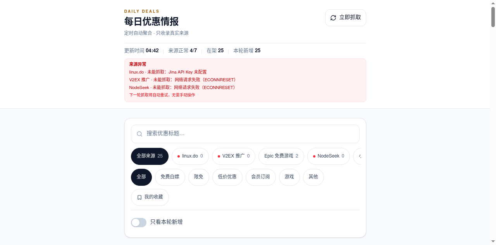

# Daily Deals · 每日优惠情报

自托管的免费 / 限免 / 低价优惠聚合站。服务端定时抓取公开 RSS 与官方接口，前端以移动端优先的卡片流展示，支持 AI 标题与摘要、AI 搜索、来源筛选、收藏与「已领」标记。

只展示真实抓取到的数据：不生成示例优惠，不用假数据填充。某个来源抓取失败时会在后台标记异常并自动重试，不会影响其他来源。

[](https://nextjs.org/)
[](https://react.dev/)
[](https://www.typescriptlang.org/)
[](https://www.docker.com/)



## 功能

- **多来源聚合**：内置 11 个真实来源，支持 RSS、Epic 官方接口与 HTML 列表解析。
- **AI 精简**：批量改写标题、生成一句话摘要、提取优惠力度与操作方式，每批默认 20 条。
- **双搜索模式**：AI 搜索先用 SQLite FTS5 全文索引召回候选，再由模型精排并返回命中 id；普通搜索匹配标题、摘要、描述、来源与分类。
- **后台可配置**：来源增删、排序、隐藏、单源刷新间隔、首页公告、站点文案与全部运行时变量。
- **响应式卡片流**：移动端单列、桌面端双列、超宽屏三列，滚动触底自动加载下一批。
- **本地状态**：收藏、已领与筛选条件只保存在当前浏览器，不上传服务端，不影响其他用户。
- **运维能力**：全屏加载动画、ETag 304、搜索与登录限流、SQLite 自动备份、来源失败飞书告警。

## 快速开始

### 1. 准备

- Docker 24+ 与 Docker Compose v2
- 能访问各来源站点的网络环境

### 2. 配置

```bash
cp .env.example .env
```

至少建议设置：

```env
# 管理后台登录密码；留空则后台不可登录
ADMIN_PASSWORD=请换成强密码

# 可选：AI 相关配置；三项缺一不可，否则自动关闭 AI 改写
LLM_BASE_URL=
LLM_API_KEY=
LLM_MODEL=
```

除 AI 接口相关的三项外，其余变量都有默认值；不配置 AI 也能正常抓取和浏览。

### 3. 启动

```bash
docker compose up -d --build
```

首次启动后会很快开始第一轮抓取，之后由调度器按来源间隔自动运行。

### 4. 访问

- 首页：<http://localhost:3000>
- 管理后台：<http://localhost:3000/admin>
- 健康检查：<http://localhost:3000/api/health>，正常返回 `{"status":"ok"}`

查看状态与日志：

```bash
docker compose ps
docker compose logs -f app
```

## 配置说明

所有运行时变量都可以在 `.env` 和管理后台「运行时配置」中修改。优先级为：

```text
管理后台保存的值  >  .env 中显式填写的非空值  >  代码默认值
```

管理后台保存后立即生效；`.env` 用于首次部署或为未在后台修改过的项提供默认值，修改后需重建容器。

- 修改 `.env` 后执行 `docker compose up -d` 重建容器生效。
- 修改后台配置保存后立即生效。
- 后台保存的值优先于 `.env`；未在后台保存过的项才读取 `.env`。想让某项重新跟随 `.env`，在后台清空该项并保存即可。
- `TZ`、`PORT`、日志轮转等容器级参数需要重建容器。

### 常用变量

| 变量 | 默认值 | 说明 |
| --- | --- | --- |
| `ADMIN_PASSWORD` | 空 | 管理后台密码，留空时后台不可登录 |
| `ADMIN_SESSION_SECRET` | 空 | 会话签名密钥，建议填写随机字符串 |
| `PORT` | `3000` | 宿主机访问端口 |
| `FETCH_INTERVAL_MINUTES` | `120` | 全局抓取间隔（分钟） |
| `DATA_RETENTION_DAYS` | `30` | 数据保留天数 |
| `LLM_ENABLED` | `true` | 是否生成 AI 标题与摘要 |
| `LLM_BASE_URL` | 空 | OpenAI 兼容接口地址，留空关闭 AI |
| `LLM_API_KEY` | 空 | AI 接口密钥，留空关闭 AI |
| `LLM_MODEL` | 空 | 模型名称，留空关闭 AI |
| `AI_SEARCH_ENABLED` | `true` | 是否允许前台使用 AI 搜索 |
| `AI_SEARCH_SCOPE` | `active` | AI 搜索范围：`active` 所有在架优惠，`days` 按天数 |
| `AI_SEARCH_DAYS` | `3` | AI 搜索按天数模式的时间范围（天） |
| `AI_SEARCH_RECALL_LIMIT` | `60` | 全文索引召回候选条数 |
| `AI_SEARCH_RERANK_LIMIT` | `20` | AI 精排最多返回条数 |
| `AI_SEARCH_FTS_ENABLED` | `true` | 是否启用 FTS5 全文索引 |
| `KEYWORD_SEARCH_DAYS` | `30` | 普通搜索时间范围（天） |
| `KEYWORD_SEARCH_MAX_RESULTS` | `100` | 普通搜索最多返回条数 |
| `SITE_LABEL` | `Daily Deals` | 首页顶部标识与加载屏底部文字 |
| `SITE_TITLE` | `每日优惠情报` | 首页主标题 |
| `SITE_TAGLINE` | `AI 精简 · 定时自动聚合 · 只收录真实来源` | 首页副标题 |
| `OUTBOUND_PROXY` | 空 | 出站代理，例如 `http://127.0.0.1:7890` |

<details>
<summary>展开全部环境变量</summary>

| 变量 | 默认值 | 说明 |
| --- | --- | --- |
| `LINUXDO_FEED_URL` | `https://linuxdorss.longpink.com/welfare.xml` | linux.do 福利 RSS，失败时自动尝试直连 |
| `JINA_API_KEY` | 空 | linux.do 最后兜底通道，可选 |
| `V2EX_FEED_URL` | `https://www.v2ex.com/feed/promotions.xml` | V2EX 推广节点 |
| `NODESEEK_FEED_URL` | `https://rss.nodeseek.com/` | NodeSeek RSS |
| `APPINN_FEED_URL` | `https://www.appinn.com/feed/` | 小众软件 RSS |
| `GHXI_FEED_URL` | `https://www.ghxi.com/feed` | 果核剥壳 RSS |
| `IPLAYSOFT_FEED_URL` | `https://www.iplaysoft.com/feed` | 异次元软件世界 RSS |
| `LOWENDBOX_FEED_URL` | `https://lowendbox.com/feed/` | LowEndBox RSS |
| `POJIE_FEED_URL` | `https://www.52pojie.cn/forum.php?mod=rss&fid=16` | 吾爱破解精品软件区（GBK 自动解码） |
| `XIANBAO_FEED_URL` | `https://new.xianbao.fun/category-weibo/` | 线报酷列表页 |
| `KUAN_FEED_URL` | `https://new.xianbao.fun/category-kuan/` | 酷安列表页 |
| `EPIC_API_URL` | Epic 官方接口 | Epic 免费游戏接口 |
| `LLM_MAX_ITEMS_PER_RUN` | `80` | 每轮最多生成摘要的条数 |
| `AI_SUMMARY_BATCH_SIZE` | `20` | 每批合并请求的条数，有效范围 5–30 |
| `AI_SUMMARY_RETRY_SIZE` | `10` | 批次缺漏时补漏小批次的最大条数 |
| `AI_SUMMARY_MAX_ATTEMPTS` | `3` | 单条摘要失败多少次后放弃 |
| `LLM_CONCURRENCY` | `3` | AI 并发请求数 |
| `LLM_TIMEOUT_MS` | `120000` | 单次批量摘要请求超时（毫秒） |
| `AI_SEARCH_RERANK_ENABLED` | `true` | 是否调用 AI 精排；关闭后直接返回索引排序结果 |
| `AI_SEARCH_USE_SUMMARY` | `true` | AI 精排时是否参考摘要 |
| `AI_SEARCH_SYNONYM_ENABLED` | `true` | 是否启用同义词扩展（白嫖→免费、云服务器→VPS 等） |
| `AI_SEARCH_INDEX_MAX_CHARS` | `400` | 每条优惠进入索引时截取的最大字符数，修改后需重建索引 |
| `AI_SEARCH_MAX_PER_SOURCE` | `0` | 每个来源最多进入多少条候选，`0` 表示不限制 |
| `AI_SEARCH_MODEL` | 空 | AI 搜索专用模型，留空沿用 `LLM_MODEL` |
| `AI_SEARCH_MAX_ITEMS` | `500` | 仅旧回退逻辑使用：最多提交的标题条数 |
| `AI_SEARCH_COARSE_STRATEGY` | `balanced` | 仅旧回退逻辑使用：`balanced` 按来源均衡，`recent` 只取最新 |
| `AI_SEARCH_CACHE_ENABLED` | `true` | 是否缓存 AI 搜索结果 |
| `AI_SEARCH_CACHE_MINUTES` | `5` | 搜索缓存时间（分钟） |
| `RATE_LIMIT_ENABLED` | `true` | 是否启用搜索与后台登录限流 |
| `SEARCH_RATE_LIMIT_PER_MINUTE` | `60` | 单 IP 每分钟搜索次数上限 |
| `ADMIN_LOGIN_RATE_LIMIT_PER_MINUTE` | `5` | 单 IP 每分钟后台登录尝试上限 |
| `ALERTS_ENABLED` | `true` | 是否启用来源连续失败告警 |
| `FEISHU_WEBHOOK_URL` | 空 | 飞书自定义机器人 Webhook，留空不推送 |
| `FEISHU_WEBHOOK_SECRET` | 空 | 飞书机器人签名密钥，可选 |
| `ALERT_FAILURE_THRESHOLD` | `3` | 连续失败多少轮后告警 |
| `ALERT_COOLDOWN_MINUTES` | `60` | 同一来源两次告警的最小间隔 |
| `BACKUP_ENABLED` | `true` | 是否自动备份 SQLite |
| `BACKUP_INTERVAL_HOURS` | `24` | 备份间隔（小时） |
| `BACKUP_KEEP` | `7` | 最多保留备份份数 |
| `BACKUP_DIR` | `./data/backups` | 备份目录 |
| `API_ETAG_ENABLED` | `true` | 数据未变化时返回 304 |
| `LOG_MAX_SIZE` | `10m` | Docker 日志单文件上限 |
| `LOG_MAX_FILE` | `3` | Docker 日志保留文件数 |
| `DATABASE_PATH` | `./data/app.db` | SQLite 文件路径 |

</details>

## AI 能力

### 标题与摘要

抓取完成后，后台会把待处理条目按批合并为一次请求，默认每批 20 条，结果按 `id` 回填到对应优惠。批次有缺漏时，同一轮会再发一个小批次补漏；单条失败达到上限后保留原标题，不再重复消耗额度。

提示词只允许基于已抓到的标题与正文改写，并做校验：输出中的 URL 丢弃、数字必须在原文中出现、「永久 / 终身 / 无限」等绝对化表述必须有原文依据。

### 搜索

搜索不再把全量数据或大批标题直接交给模型，流程为：

1. **查询预处理**：按空格与标点切分，展开同义词（白嫖→免费/限免、云服务器→VPS/主机等）。
2. **全文召回**：SQLite FTS5 全文索引按 BM25 召回 Top 120；中文按二元词（bigram）建索引，单字查询自动走 `LIKE` 兜底。
3. **本地二次排序**：叠加新鲜度，并按来源配额裁剪，默认取前 60 条候选。
4. **AI 精排**：只把候选的标题与摘要交给模型，最多返回 20 条命中 id；模型不可用时回退为索引排序结果。

- **AI 搜索**：默认搜索所有在架优惠，也可在后台切换为按天数；结果默认缓存 5 分钟。
- **普通搜索**：默认最近 30 天，匹配标题、摘要、描述、来源与分类，最多返回 100 条。
- FTS5 不可用、无命中或关闭全文索引时，会自动回退到 `LIKE` 扫描与旧粗筛逻辑。

索引会在启动时自动校验并补建，抓取、摘要更新与清理时同步维护；后台「搜索索引」区域可查看索引状态并手动重建。两种模式都只筛选已入库内容，不会虚构优惠。

## 管理后台

访问 `/admin` 登录后可：

- 查看来源状态、最近抓取时间、异常原因与在架条数
- 手动触发抓取、调整来源顺序、隐藏或显示来源
- 新增 / 删除自定义 RSS 或 Epic 来源
- 为单个来源设置独立刷新间隔
- 编辑首页公告，并单独保存
- 查看搜索索引状态、索引条数与最近重建时间，并可手动重建
- 修改站点文案与全部运行时变量，保存后立即生效

内置来源不能删除，只能隐藏或修改地址；删除自定义来源会同时删除其已入库条目。

## 数据来源

| 来源 | 地址 | 格式 |
| --- | --- | --- |
| linux.do 福利 | `https://linuxdorss.longpink.com/welfare.xml` | RSS |
| V2EX 推广 | `https://www.v2ex.com/feed/promotions.xml` | RSS |
| Epic 免费游戏 | Epic 官方 `freeGamesPromotions` 接口 | JSON |
| NodeSeek | `https://rss.nodeseek.com/` | RSS |
| 小众软件 | `https://www.appinn.com/feed/` | RSS |
| 果核剥壳 | `https://www.ghxi.com/feed` | RSS |
| 异次元软件世界 | `https://www.iplaysoft.com/feed` | RSS |
| LowEndBox | `https://lowendbox.com/feed/` | RSS |
| 吾爱破解 | `https://www.52pojie.cn/forum.php?mod=rss&fid=16` | RSS |
| 线报酷 | `https://new.xianbao.fun/category-weibo/` | HTML |
| 酷安 | `https://new.xianbao.fun/category-kuan/` | HTML |

- 各来源并行抓取，单源超时不会阻塞其他来源。
- 按原文链接去重，链接首次出现时标记为本轮新增。
- 清理超过保留天数的条目，以及已过期的 Epic 限免。
- 类别自动归类：免费白嫖、限免、低价优惠、会员订阅、游戏、其他。

## 数据、备份与安全

- 抓取数据保存在 `./data/app.db`，该目录通过 Docker volume 持久化。
- 默认每天自动备份一次，保留 7 份，位置 `./data/backups`。
- 收藏、已领与筛选条件只存在浏览器 `localStorage`，不写入服务端。
- 首页只展示标题、摘要与原文链接，不复制来源全文。
- 请务必设置强 `ADMIN_PASSWORD`，不要把 `.env` 提交到公开仓库。

手动备份：

```bash
docker compose stop
tar -czf "backup-$(date +%Y%m%d-%H%M%S).tar.gz" data
docker compose start
```

恢复：

```bash
docker compose down
rm -rf data
tar -xzf backup-YYYYMMDD-HHMMSS.tar.gz
docker compose up -d
```

## API

| 方法 | 路径 | 说明 |
| --- | --- | --- |
| GET | `/api/health` | 健康检查 |
| GET | `/api/deals` | 在架条目、来源状态与统计，支持 ETag |
| POST | `/api/fetch` | 管理员手动触发抓取 |
| POST | `/api/search` | 搜索，Body：`{"query":"...","mode":"ai"\|"keyword"}` |
| POST | `/api/admin/sources` | 新增 / 删除来源 |
| POST | `/api/admin/settings` | 保存公告、来源配置与运行时变量 |

## 本地开发

需要 Node.js 22+，以及构建 `better-sqlite3` 所需的系统工具。

```bash
npm install
cp .env.example .env
npm run dev
```

生产构建：

```bash
npm run build
npm start
```

## 目录结构

```text
app/                 Next.js App Router 页面与 API
components/          卡片流、筛选、加载动画与 UI 组件
lib/fetchers/        各来源抓取与解析
lib/db.ts            SQLite schema、去重与查询
lib/search-text.ts   中文二元分词、同义词与 FTS 查询构造
lib/search-index.ts  FTS5 索引维护、召回与状态
lib/llm.ts           AI 摘要与搜索
lib/scheduler.ts     定时抓取调度
data/                数据库与备份（不提交）
docker-compose.yml   单容器编排
```

## 免责声明

本项目仅用于聚合公开信息，所有优惠内容的版权归原站点所有。请遵守各来源站点的使用条款；本项目不保证信息的时效性与准确性，交易前请以原文为准。

## 参与贡献

欢迎提交 Issue 或 Pull Request。新增来源时请确保该来源允许抓取，并遵守其 robots 与使用条款。
